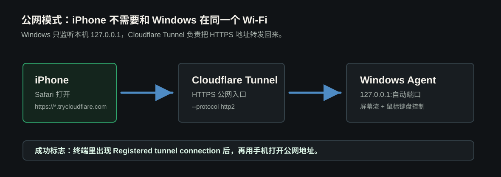
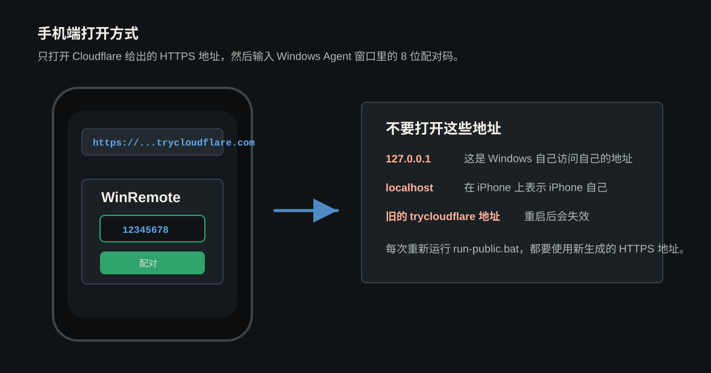
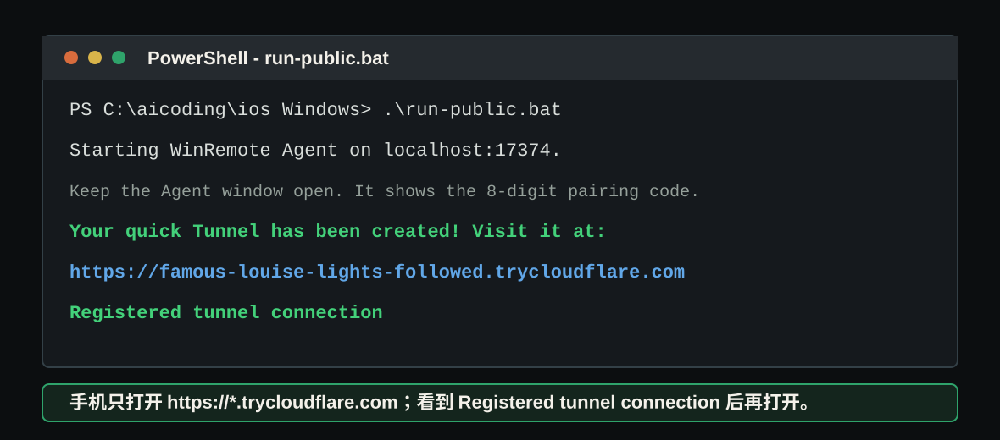
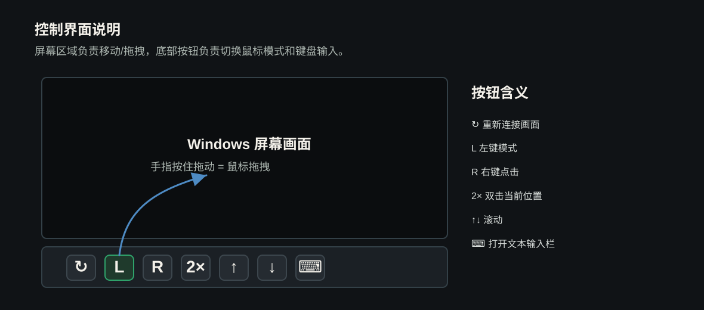

# WinRemote

WinRemote 是一个 **iPhone/Safari 远程控制 Windows** 的开源 MVP。Windows 端运行一个可见的 Agent，iPhone 打开网页控制台，就可以看到 Windows 屏幕并发送鼠标、键盘操作。

它支持两种使用方式：

- **局域网模式**：iPhone 和 Windows 在同一个 Wi-Fi 下使用。
- **公网模式**：iPhone 不需要和 Windows 在同一个 Wi-Fi，通过 Cloudflare Tunnel 打开 HTTPS 地址。

> 当前状态：MVP / 实验版。适合学习、验证产品思路、个人授权设备使用，还不是 TeamViewer / AnyDesk 的成熟替代品。



## 先说清楚：手机打开哪个地址？

如果你运行的是公网模式：

```powershell
.\run-public.bat
```

手机 Safari 只打开终端里出现的这个地址：

```text
https://xxxx-xxxx-xxxx.trycloudflare.com
```

不要打开这些：

- `127.0.0.1`
- `localhost`
- 旧的 `trycloudflare.com` 地址
- Windows Agent 窗口里显示的本机地址

每次重新运行 `run-public.bat`，Cloudflare 都可能生成一个新的公网地址，所以手机要打开**最新的** `https://*.trycloudflare.com`。



## 公网模式：不需要同一个 Wi-Fi

这是最常用的方式。Windows 在家里、公司或另一张网络里，iPhone 用蜂窝网络也可以访问。

### 1. 在 Windows 上运行

```powershell
cd "C:\aicoding\ios Windows"
.\run-public.bat
```

脚本会自动做这些事：

- 编译 WinRemote Agent
- 自动找一个没有被占用的本机端口
- 启动 Agent
- 如果缺少 `cloudflared.exe`，自动下载
- 启动 Cloudflare HTTPS 隧道
- 强制使用 HTTP/2，避免部分网络阻断 QUIC/UDP

### 2. 等待成功标志

终端里会出现类似内容：



你需要看两行：

```text
https://famous-louise-lights-followed.trycloudflare.com
Registered tunnel connection
```

看到 `Registered tunnel connection` 以后，隧道才真正连上。然后手机打开那条 `https://...trycloudflare.com` 地址。

### 3. 输入配对码

`run-public.bat` 会打开另一个窗口，标题类似 `WinRemote Agent`。这个窗口里会显示：

```text
Pair code: 12345678
```

在 iPhone 页面输入这 8 位配对码即可连接。

## 局域网模式

如果 iPhone 和 Windows 在同一个 Wi-Fi 下，可以运行：

```powershell
.\run.bat
```

然后用 iPhone Safari 打开终端里打印的局域网地址，例如：

```text
http://192.168.1.23:17373
```

公网使用时不需要这个局域网地址。

## 控制界面



支持：

- 触摸屏幕：移动鼠标
- 按住拖动：左键拖拽
- `L`：左键模式
- `R`：右键点击
- `2x`：双击
- `↑` / `↓`：滚动
- `⌨`：打开文本输入栏

## 功能

- Windows 屏幕 MJPEG 视频流
- iPhone Safari 控制页面
- 鼠标移动、点击、拖拽、右键、双击、滚动
- 文本和基础键盘输入
- 8 位配对码
- token 保护控制接口
- Cloudflare Tunnel 公网 HTTPS 访问
- HTTP/2 隧道模式，降低网络兼容问题
- Windows 当前用户登录后自启脚本

## 安全边界

WinRemote 只用于控制你自己的设备，或你被明确授权管理的设备。

它不会、也不应该支持：

- 隐藏运行
- 未授权访问
- 窃取凭据
- 绕过 Windows 锁屏
- 绕过 Windows 登录界面
- 绕过 UAC 安全桌面
- 规避杀毒软件或安全软件

Windows 锁屏、登录界面、UAC 安全桌面是系统安全边界。当前 MVP 不控制这些界面。

## 常见问题

| 问题 | 解决方式 |
| --- | --- |
| 手机打不开公网地址 | 等终端出现 `Registered tunnel connection` 后再打开 |
| 手机打开了 `127.0.0.1` | 这是错误地址。手机只能打开 `https://*.trycloudflare.com` |
| 页面不是 WinRemote | 旧版本可能端口被占用。重新运行最新版 `run-public.bat`，它会自动找空闲端口 |
| 重启脚本后旧地址不能用了 | 正常。临时 Cloudflare 地址每次可能变化 |
| 屏幕显示占位图 | Agent 需要运行在已登录、未锁屏的 Windows 桌面会话里 |
| 控制不了 UAC 弹窗 | 正常。UAC 安全桌面不能被普通 Agent 控制 |

更多排障见 [Troubleshooting](docs/TROUBLESHOOTING.md)。

## 构建和测试

当前版本不需要 NuGet 包，使用 Windows 自带的 .NET Framework 编译器：

```powershell
.\build.bat
```

运行 smoke test：

```powershell
.\scripts\smoke-test.ps1
```

## 项目结构

```text
src/                         Windows Agent 源码
public/                      iPhone/Safari 控制页面
scripts/                     PowerShell 辅助脚本
docs/                        文档和配图
build.bat                    编译 Agent
run.bat                      局域网模式启动
run-public.bat               公网 Cloudflare Tunnel 启动
install-autostart.bat        安装当前用户登录后自启
```

不会提交到 GitHub 的生成物：

- `bin/`
- `tools/`
- `.runtime*/`

`cloudflared.exe` 会由 `scripts/download-cloudflared.ps1` 按需下载，不会放进仓库。

## 文档

- [Quick Start](docs/QUICKSTART.md)
- [Public Access](docs/PUBLIC_ACCESS.md)
- [Architecture](docs/ARCHITECTURE.md)
- [Security Model](docs/SECURITY_MODEL.md)
- [Troubleshooting](docs/TROUBLESHOOTING.md)
- [Roadmap](docs/ROADMAP.md)
- [Publishing to GitHub](docs/PUBLISHING.md)

## 开源协议

MIT。见 [LICENSE](LICENSE)。
