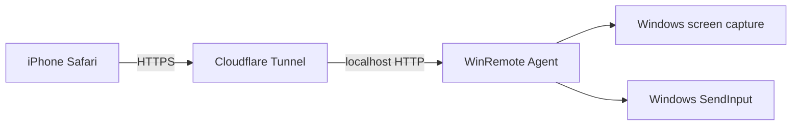

# Architecture

## Components

### Windows Agent

Path: `src/WinRemoteAgent.cs`

Responsibilities:

- Serve static UI assets from `public/`
- Generate an 8-digit pairing code and random token
- Authorize requests by token or paired session cookie
- Capture the current Windows desktop
- Stream MJPEG frames
- Inject mouse and keyboard events with Windows APIs

### Web Controller

Path: `public/`

Responsibilities:

- Pair with the Agent
- Display MJPEG screen stream
- Convert touch input to normalized screen coordinates
- Send mouse, wheel, and keyboard commands

### Public Tunnel

Path: `run-public.bat`

Responsibilities:

- Pick a free local port
- Start the Agent on `127.0.0.1`
- Start Cloudflare Tunnel with HTTP/2
- Print the public HTTPS URL

## Current Transport

The MVP uses MJPEG because it is simple and works in Safari without extra dependencies. It is not bandwidth efficient. A production version should move screen streaming to WebRTC or a similarly efficient real-time video transport.

## Windows Session Limitations

The Agent must run inside the user's interactive desktop session. Windows lock screen, login screen, and UAC secure desktop are separate protected contexts and are not controlled by this MVP.
